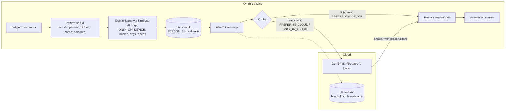

# Blindfold

[](LICENSE)

**Ask AI about documents you can't show AI.**

Blindfold is a web app for people who handle other people's data: freelancers, bookkeepers, small-business owners. Paste a contract, a client email or a bank statement, and Blindfold swaps every name, company, amount and account number for a placeholder **on your device**. The cloud model only ever works on the blindfolded copy. When the answer comes back, the real values are restored locally from a vault that never leaves the browser.

It is built on **Firebase AI Logic hybrid inference**: Gemini Nano in Chrome does the private work on-device, Gemini in the cloud does the heavy reasoning, and the app shows you exactly which one ran and exactly what it was sent.

Built for the [#BuildHybridAI 2026 hackathon](https://firebasehybridaihackathon.devpost.com/) (platform: Web / Chrome).

## Why hybrid, and not just "on-device with a fallback"

Most hybrid apps treat the two models as interchangeable: try local, fall back to cloud. Blindfold composes them inside one request, because each is good at something the other cannot do:

| | On-device (Gemini Nano) | Cloud (Gemini) |
| --- | --- | --- |
| Sees the original document | Yes | **Never** |
| Job | Find names, companies, addresses; answer light tasks | Long documents, risk review, drafting |
| Cost per request | Free | Metered |
| Works offline | Yes | No |

The result is a privacy boundary you can see on screen: the left pane is your document, the right pane is the only copy that is allowed to leave.

## How it works



1. **Blindfold.** Deterministic patterns catch structured identifiers instantly. Then the on-device model finds what patterns cannot: free-form names, companies and addresses. Each value gets a stable placeholder such as `[PERSON_1]`.
2. **Review.** You see both versions side by side. Click a highlight to let a value through, select any text to blindfold it by hand, or toggle a whole category (for example, let amounts through so the model can add them up).
3. **Route.** Every request is routed by a small, unit-tested policy to one of the four Firebase AI Logic inference modes.
4. **Check.** Before anything is sent, a leak check scans the exact outgoing payload for every protected value. If one is found, the request is not sent.
5. **Restore.** The answer arrives with placeholders. The vault restores real values on screen, and you can flip any answer to "as the model wrote it" to see what the model actually knew.

## How Firebase AI Logic is used

All model calls are in [`src/lib/ai.ts`](src/lib/ai.ts) and go through `getGenerativeModel(ai, { mode, inCloudParams, onDeviceParams })` from `firebase/ai`.

| Step | Inference mode | Why |
| --- | --- | --- |
| Entity detection | `ONLY_ON_DEVICE` with a JSON `responseConstraint` | The original text must not leave the device. |
| Entity detection, device has no model | none by default; `ONLY_IN_CLOUD` with `responseSchema` if the user opts in | Honest fallback: patterns are masked first, and the user is told names will be visible for that one step. |
| Light tasks (summarize, action items) | `PREFER_ON_DEVICE` | Free and private when possible; the SDK falls back to the cloud with the blindfolded text. |
| Heavy tasks (risk review, drafting, questions) | `PREFER_IN_CLOUD`, or `ONLY_IN_CLOUD` when the prompt exceeds the on-device budget | Better reasoning; falls back to the device if the cloud is unreachable. |
| Offline, or "Strict local" switch | `ONLY_ON_DEVICE` | Never silently use the cloud. If it cannot run locally, the request is blocked with a reason. |
| Screenshot to text | `ONLY_ON_DEVICE` multimodal; `ONLY_IN_CLOUD` only after a confirmation | Image input stays local when a model is available. |

Every answer is labelled from `response.inferenceSource` (`ON_DEVICE` or `IN_CLOUD`), together with the mode that was requested and the exact payload. The routing policy is a pure function in [`src/lib/router.ts`](src/lib/router.ts).

Other Firebase products:

- **App Check** (required by AI Logic): reCAPTCHA Enterprise in production, debug provider in development, limited-use tokens for replay protection. See [`src/lib/firebase.ts`](src/lib/firebase.ts).
- **Remote Config**: cloud model names (free-tier `gemini-3.5-flash-lite` by default; point `cloud_model` at a larger model when the project has billing), the on-device token budget, detection chunk size and whether cloud-assisted detection may be offered. The routing policy can be tuned without a deploy. Template: [`remoteconfig.template.json`](remoteconfig.template.json).
- **Authentication**: anonymous by default, optional upgrade to Google so threads follow you across devices.
- **Cloud Firestore**: stores **only** the blindfolded document and blindfolded answers, with offline persistence. Rules in [`firestore.rules`](firestore.rules) restrict each thread to its owner and validate its shape. Open a thread on another device and you get the placeholders, not the values, because the vault stayed where it was created.
- **Hosting**: static deploy with an offline shell (service worker), so the on-device path keeps working with no connection.

## Run it

Requirements: Node.js 20+, a Firebase project, desktop Chrome.

```bash
npm install
cp .env.example .env.local   # then fill in your Firebase web app config
npm run dev                  # http://localhost:5173
```

Without a Firebase config the app still opens in "pattern shield only" mode, so you can inspect the boundary and the outgoing payloads before connecting anything.

### Firebase setup

```bash
npx -y firebase-tools@latest login
npx -y firebase-tools@latest use --add                     # pick your project
npx -y firebase-tools@latest apps:create WEB "Blindfold"   # then: apps:sdkconfig WEB <appId>
npx -y firebase-tools@latest init ailogic                  # interactive: enables Firebase AI Logic for the web app
npx -y firebase-tools@latest deploy --only firestore,remoteconfig,auth
```

The deploy creates the Firestore database, releases the rules, publishes the Remote Config template and enables anonymous sign-in (all declared in `firebase.json`). Copy the web app config into `.env.local`.

Coding agents can do the same through the Firebase MCP server in `.mcp.json`: its `firebase_init` tool enables AI Logic, Auth and Firestore without the interactive prompts.

App Check (required by Firebase AI Logic):

- Make sure the **Firebase App Check API** is enabled for the project (open **Security > App Check** in the console once), and that enforcement is on for Firebase AI Logic.
- Development: register a debug token and keep it in `.env.local` (never commit it).

  ```bash
  npx -y firebase-tools@latest appcheck:debugtokens:create --app <appId> --display-name "Local dev"
  ```

  Put the printed token in `VITE_APPCHECK_DEBUG_TOKEN`.
- Production: set `VITE_RECAPTCHA_ENTERPRISE_SITE_KEY` (reCAPTCHA Enterprise) or `VITE_RECAPTCHA_V3_SITE_KEY` (classic reCAPTCHA v3) and register the same key under **Security > App Check > Apps**.

Optional: enable Google under **Authentication > Sign-in method** to sync blindfolded threads across devices.

Note: Google decides per project whether the Gemini API free tier is available. If cloud requests return "free tier is not available for this project", link a billing account to the project. On-device requests are unaffected.

### On-device model in Chrome

- Desktop Chrome 139 or newer on Windows, macOS, Linux or Chromebook Plus.
- Hardware: more than 4 GB of VRAM, **or** 16 GB of RAM with 4+ CPU cores; 22 GB of free disk space on the profile volume.
- For screenshot reading, enable `chrome://flags/#prompt-api-for-gemini-nano-multimodal-input` and restart.
- Click **Enable on-device AI** in the header to download the model once. Check its state at `chrome://on-device-internals`.
- On-device input and output is English (Chrome also supports Spanish, Japanese, German and French).

On any other browser or device, Blindfold runs in fallback mode: pattern shield plus the cloud model on blindfolded text.

### Test, build, deploy

```bash
npm test          # 40 unit tests: detectors, vault, leak check, routing, hybrid orchestration, rendering
npm run build
npm run deploy    # build + firebase deploy (hosting, rules, Remote Config)
```

## Project layout

```
src/lib/detectors.ts     Pattern shield (regex + validation, e.g. Luhn for cards)
src/lib/pseudonymize.ts  Vault, masking, restoring, leak check
src/lib/router.ts        Routing policy -> Firebase AI Logic inference mode
src/lib/ai.ts            All Firebase AI Logic calls (hybrid inference)
src/lib/firebase.ts      App, App Check, Auth, Firestore, Remote Config
src/lib/store.ts         Local vault storage vs. Firestore (blindfolded only)
src/lib/prompts.ts       Task presets and the single-string prompts
src/components/          Header, intake, two-pane workspace, conversation
firestore.rules          Owner-only, shape-validated threads
remoteconfig.template.json
```

## Limits worth knowing

- Detection is not perfect. Patterns are precise but narrow; the on-device model is broader but can miss a name. That is why the blindfolded copy is always shown before you ask, and why you can blindfold any selection by hand.
- A blindfolded amount cannot be added up by the cloud model. Let the Amounts category through when you need arithmetic.
- The context of a document can identify someone even without their name. Blindfold reduces what the cloud can see; it does not make a document anonymous.
- On devices without a local model, names are protected only by patterns unless the user opts in to cloud-assisted detection.
- On-device speed depends on the hardware. Measured on a laptop with integrated graphics (Intel Iris Xe, 16 GB RAM, Chrome 158): name detection on a one-page contract about 70 s, light tasks 25 to 70 s, a heavy task under Strict local about 3 minutes. The first request after the model loads is slower.
- The original text and the vault are kept in the browser's local storage, and only for threads you have saved. "Wipe local vault" removes them; after that, saved threads show placeholders only.

## Built with

Firebase AI Logic (hybrid inference), Gemini Nano in Chrome, Gemini Developer API, Firebase App Check, Remote Config, Authentication, Cloud Firestore, Firebase Hosting, React, TypeScript, Vite, Vitest. Developed with Claude Code using the [Firebase agent skills](https://firebase.google.com/docs/ai-assistance/agent-skills) (pinned in `skills-lock.json`; restore them with `npx skills experimental_install`) and the Firebase MCP server (`.mcp.json`).

## License

[MIT](LICENSE)
